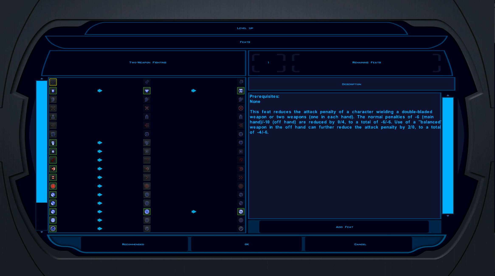
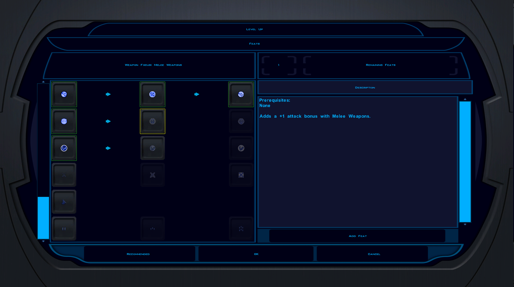

# K1 High-Res Feat & Power Trees

An exe patch for **Star Wars: Knights of the Old Republic** (PC, 2003). At high resolutions it scales the
feat and Force power selection icons with the rest of the
[KotOR High Resolution Menus](https://deadlystream.com/files/file/1159-kotor-high-resolution-menus/) UI.

The engine builds every feat and power tree row with a hardcoded 40 px height and 32 px arrows, and never
reads these sizes from the `.gui` files. High Resolution Menus therefore can't enlarge them, and the icons stay
640x480-sized at any resolution. This patcher rescales the hardcoded sizes by `menu height / 480` and makes the
icon pictures stretch to fill them.

| Before | After |
|---|---|
|  |  |

**Download:** [DeadlyStream](https://deadlystream.com/files/file/3161-k1-high-res-feat-power-trees/) · [Nexus Mods](https://www.nexusmods.com/kotor/mods/1906) · [GitHub release](https://github.com/phalladar/k1-hires-feat-trees/releases/latest). Requires the KOTOR
Editable Executable (Steam only), UniWS and KotOR High Resolution Menus.

- `mod/` is exactly what ships: `Install.bat`, `Uninstall.bat`, `K1FeatTrees.ps1` (Windows PowerShell 5.1,
  no dependencies), `README.txt` and `TECHNICAL.txt` (the byte-level table).
- `tests/` holds end-to-end tests that run the real script against local copies of game executables. Those
  copies are not included; see the docstring for the env vars.
- `python build.py` writes `dist/K1-HiRes-Feat-Trees-<version>.zip`.

```
python -m unittest discover -s tests -v
python build.py
```

MIT licensed.
